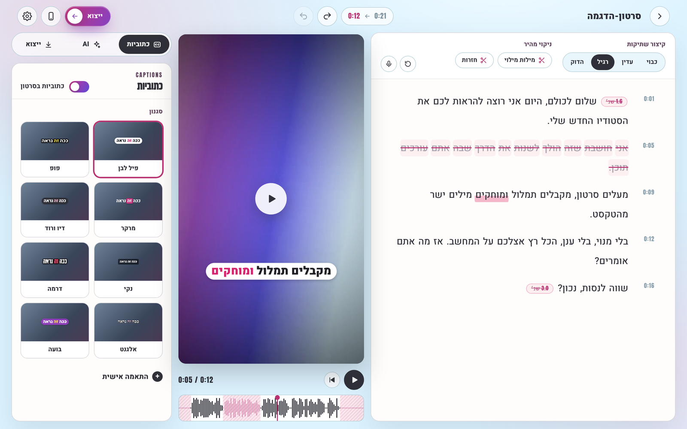

# הסטודיו שלי

עורך וידאו שרץ כולו על המחשב שלך, בדפדפן. טיימליין רב-ערוצי, חיתוך ישר מהתמלול, כתוביות בעברית ובאנגלית, קריינות, וסוכן AI שעורך לצידך דרך MCP. בלי מנוי, בלי ענן, והצילומים לא עוזבים את המחשב.



## מה יש בפנים

- **חיתוך מהיר**: קיצור קצוות, פיצול, סימון טווח עם I ו-O, חיתוך הטווח, והסרת שתיקות אוטומטית. גוררים קליפ בין קליפים, והם זזים לפנות לו מקום.
- **עריכה דרך הטקסט**: מסמנים מילים בתמלול ומוחקים, והקטע נחתך מהסרטון. יש גם הסרת מילות מילוי וחזרות בלחיצה.
- **כתוביות**: תמלול מקומי בעברית (המודלים של ivrit.ai) ובשאר השפות, הדגשה מילה במילה, 9 סגנונות. אפשר לתרגם ולהציג מקור, תרגום, או שתי השפות יחד.
- **קריינות**: טקסט שהופך לקריינות על הטיימליין, בקול מוכן או בקול ששובט מהקלטה שלך.
- **תנועה**: זומים עם קיפריימים (K), מהירות מ-0.25× עד 4×, כותרות, 8 מעברים, 13 לוקים ו-26 אפקטים קוליים.
- **סאונד וייצוא**: עוצמה ופיידים לכל קליפ, הפרדת אודיו מהווידאו, וייצוא של כמה פורמטים בבת אחת (16:9, 9:16, 1:1, 4:5), עד 60 פריימים.
- **מאגר חינמי**: B-roll, אוברליי, תמונות ומוזיקה מ-Pexels, Pixabay ו-Openverse, עם קובץ קרדיטים אוטומטי.
- **נבנה לסוכני AI**: כל עריכה היא גם כלי MCP וגם קריאת REST. 62 כלים.
- **גם מהנייד**: סורקים QR, מעלים מהגלריה, עורכים את התמלול, מוסיפים כתוביות ומייצאים, כשהמחשב עושה את העבודה.

## הפעלה

צריך חיבור לאינטרנט רק בהפעלה הראשונה.

**מק**: לחיצה כפולה על `start.command`. אם המק חוסם את הקובץ, פותחים את האפליקציה Terminal, מקלידים `bash` ורווח, גוררים את הקובץ לחלון ולוחצים Enter.

**ווינדוס**: מחלצים את ה-ZIP (קליק ימני, Extract All) ומעבירים את התיקייה `studio` ל-`C:\studio`, כדי שהנתיב יהיה קצר ובאנגלית. לחיצה כפולה על `start.bat`. אם מופיעה אזהרה כחולה, לוחצים More info ואז Run anyway. אם חומת האש שואלת, מאשרים גישה ברשתות פרטיות (זה נדרש רק לחיבור מהנייד).

**לינוקס**: `./start.sh`

בהפעלה הראשונה מותקנים הרכיבים אוטומטית (כמה דקות), ואז הדפדפן נפתח בכתובת `http://localhost:8765`. בתמלול הראשון יורד מודל התמלול (1.6GB, פעם אחת). כדי לסגור את הסטודיו סוגרים את החלון השחור.

## איך עורכים

1. גוררים סרטון למסך הבית. הוא נוחת על הטיימליין והתמלול מתחיל לבד.
2. בלשונית **תמלול** מסמנים מילים ולוחצים **מחיקה**. מעל הטיימליין בוחרים רמה ב**הסרת שתיקות**.
3. בוחרים קליפ בטיימליין, ובפאנל המאפיינים משנים מהירות, עוצמה, לוק, זום ומעבר.
4. בלשוניות שבצד מוסיפים כתוביות, כותרות, קריינות, אפקטים, מוזיקה ו-B-roll. הכל נוסף במקום שבו עומד הסמן.
5. בלשונית **ייצוא** מסמנים פורמט אחד או יותר ולוחצים **ייצוא**.

| פעולה | מקש |
|---|---|
| נגן / עצור | Space |
| פיצול בסמן | S |
| מחיקת הקליפ הנבחר | Delete |
| תחילת טווח / סוף טווח | I / O |
| חיתוך הטווח | X |
| קיפריים של זום | K |
| פריים אחורה / קדימה | ← / → |
| ביטול / ביצוע מחדש | Ctrl+Z / Ctrl+Shift+Z |
| זום בטיימליין | Ctrl + גלגלת |

הערוץ הראשי (וידאו 1) רציף: הקליפים בו מתנגנים אחד אחרי השני בלי רווחים. בשאר הערוצים הפריטים חופשיים בזמן, והם נשארים צמודים לתוכן שמתחתם גם כשחותכים לפניו.

## סוכן AI שעורך איתך (MCP)

הסטודיו הוא שרת MCP. מחברים אליו את Claude Code, Claude Desktop, Cursor, VS Code או כל לקוח MCP אחר, מבקשים במילים, ורואים את הטיימליין משתנה בזמן אמת. כל שינוי של הסוכן נכנס להיסטוריה ואפשר לבטל אותו.

```bash
claude mcp add --transport http studio http://127.0.0.1:8765/mcp
```

ואז, למשל: ״תסיר את השקטים, תוסיף כתוביות בעברית ותייצא גרסת 9:16״.

אותן פעולות זמינות גם ב-REST:

```bash
curl -X POST http://127.0.0.1:8765/api/projects/<id>/ops \
  -H 'Content-Type: application/json' \
  -d '{"op": "remove_silences", "args": {"level": "normal"}}'
```

הרשימה המלאה של הפעולות והפרמטרים: `http://127.0.0.1:8765/api/ops`, או הכפתור **API · MCP** בעורך. החיבור פתוח רק מהמחשב עצמו.

## חיבורים (הכל אופציונלי)

הכל בהגדרות, והמפתחות נשמרים רק בקובץ `data/settings.json` במחשב.

| מה | בשביל מה | אפשרויות |
|---|---|---|
| מודל AI | עריכה לפי הנחיה, תרגום כתוביות, טקסטים לפוסט | Ollama (מקומי, חינם), Claude, או כל שירות בפורמט של OpenAI |
| שירות קול | קריינות ושיבוט קול | Cartesia או ElevenLabs |
| מאגר וידאו | B-roll ואוברליי | מפתח חינמי של Pexels או Pixabay |

בלי שום חיבור עובדים: תמלול, כל העריכה, כתוביות, כותרות, אפקטים קוליים, ייצוא, ותמונות ומוזיקה מ-Openverse.

כשעובדים עם מודל AI בענן, התמלול (טקסט בלבד, לא הווידאו) נשלח לספק המודל. טקסט לקריינות ודגימת קול לשיבוט נשלחים לשירות הקול. משבטים רק קול שלך, או קול שקיבלת רשות להשתמש בו.

## מהנייד

1. לוחצים על סמל הטלפון בראש המסך. מופיע קוד QR.
2. מחברים את הנייד לאותה רשת Wi-Fi של המחשב וסורקים.
3. מעלים סרטון, עורכים את התמלול, בוחרים כתוביות ומייצאים. המחשב צריך להישאר דלוק.

רק מי שסרק את הקוד יכול להיכנס, ואת ההגדרות אפשר לשנות רק מהמחשב. מחוץ לבית מתחברים דרך [Tailscale](https://tailscale.com). אם הנייד לא מתחבר, בדרך כלל חומת האש חוסמת: בהפעלה הראשונה מאשרים לסטודיו לקבל חיבורים נכנסים.

## פונט משלך

קובצי `.ttf` או `.otf` בתיקייה `fonts/custom` מופיעים ברשימת הפונטים של הכתוביות והכותרות. קובץ בשם `brand.otf` שם משמש גם לכותרות של הממשק.

## איפה הכל נשמר

בתיקייה `data`: הפרויקטים, הקבצים שהועלו, הייצואים, מודלי התמלול וההגדרות. מחיקת התיקייה מאפסת את הסטודיו.

## דרישות

- מק עם macOS 12 ומעלה (Apple Silicon או אינטל), ווינדוס 10 או 11 בגרסת 64 ביט, או לינוקס.
- כ-4GB פנויים בדיסק ו-8GB זיכרון.
- דפדפן Chrome או Edge עדכני לעריכה במחשב.

## למפתחים

```bash
uv sync                 # התקנה כולל כלי פיתוח
uv run pytest           # 83 בדיקות, כולל סנכרון קול ותמונה אחרי חיתוכים ושרת ה-MCP
uv run python -m app    # הפעלה. --port לשינוי פורט, --host 127.0.0.1 לחסימת גישה מהרשת
```

| קובץ | תפקיד |
|---|---|
| `app/model.py` | מסמך הפרויקט: מדיה, ערוצים, פריטים, היסטוריה |
| `app/compose.py` | הופך את המסמך לטיימליין מדויק לפריים |
| `app/ops.py`, `app/ops_jobs.py` | כל פעולות העריכה, ברישום אחד שמשמש את הממשק, ה-REST וה-MCP |
| `app/export.py` | ייצוא עם ffmpeg |
| `app/mcp_server.py` | שרת ה-MCP |
| `app/captions.py`, `app/bidi.py` | ציור כתוביות וכותרות, כולל סדר ימין-לשמאל |
| `app/transcribe.py`, `app/voice.py`, `app/stock.py`, `app/ai/` | תמלול, קול, מאגר ומודלים |
| `app/web/` | הממשק, בלי שלב build |
